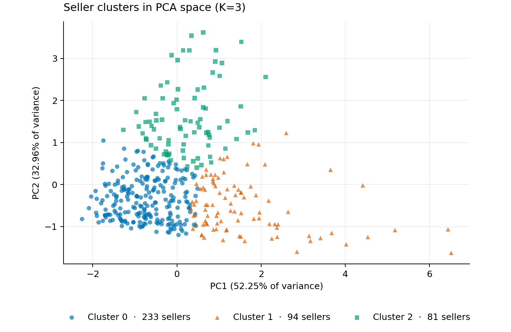

# Olist 电商经营与履约分析

从九张电商关系表出发，使用 **Python → Parquet → MySQL → Power BI**，分析经营增长、履约与评价、卖家优先级和客户复购。项目包含清洗代码、测试、30 个专题 SQL 查询、回归与聚类分析、课程文档，以及可复查的结果快照。

**数据窗口**：2017-01-01 ≤ 下单时间 < 2018-09-01。全量历史的 99,441 笔订单用于数据盘点与入库核对，窗口内有 99,092 笔下单、96,211 笔最终已交付订单。商品金额单位为巴西雷亚尔 BRL，计算过程使用整数分。

## 可以先看什么

- [分析结果汇总](reports/analysis_v1/README.md)：月度经营、品类地区、履约评价、客户和卖家结果。
- [结果文件索引](reports/analysis_v1/result_index.csv)：22 张导出表的文件名、行数与计算口径。
- [数据清洗和质量报告](reports/)：各阶段缺失、主键、金额、时间和关联检查。
- [Power BI 八页项目](powerbi/Olist/Olist.pbip)：报表与本地语义模型一起提供；请在 Desktop 中打开。
- [指标字典与业务建议](docs/47_项目交付核对与答辩.md)：指标分母、可复查的发现及建议验证方案。
- [完整学习路线](docs/00_项目路线.md)：包括 23 份 Notebook 和后续课程。

## 关键发现

| 问题 | 结果 | 证据 |
| --- | --- | --- |
| 经营增长从哪里来 | 2017 年 11 月商品成交额比 10 月增加 **339,517.72 BRL**。订单量贡献 **+406,928.13**，客单价贡献 **−67,410.41 BRL** | [月度拆解](reports/analysis_v1/monthly_business.csv)、Q06 |
| 哪些品类和地区贡献增量 | 11 月增量最高品类 `bed_bath_table` 增加 **41,949.93 BRL**；客户州 SP 增加 **130,986.10 BRL** | [品类增量](reports/analysis_v1/category_november_growth.csv)、[州增量](reports/analysis_v1/state_november_growth.csv) |
| 履约与评价如何关联 | **6,531 / 96,203 = 6.79%** 的可判断订单延迟。按时或提前组低评率 **9.25%**，延迟 8–14 天组 **80.15%** | [延迟分档](reports/analysis_v1/delay_bands_and_reviews.csv)、Q17–Q19 |
| 州构成能解释多少低评差异 | 延迟组与按时或提前组的低评率差，直接汇总为 **53.17 个百分点**，共用州权重后为 **50.46 个百分点** | [标准化结果](reports/analysis_v1/state_standardization.csv)、Q22 |
| 优先核查哪些卖家 | 408 位卖家达到双样本门槛，**102 位**同时高于延迟和低评两条基线；名单保留具体受影响订单数 | [全量候选名单](reports/analysis_v1/seller_candidates.csv)、Q27、Q31 |
| 客户是否有足够随访时间 | 2018-05 首购客户完整 90 天复购率为 **105 / 6,508 = 1.61%**。2018-06 的 90 天窗口仍有 **5,563 位**客户未成熟，结果留空 | [30/60/90 天 Cohort](reports/analysis_v1/customer_cohort.csv)、Q14 |

以上为历史数据中的描述与关联。建议尚未实施，不能将相关性或拟合概率差写成已验证的运营收益。



聚类使用标准化后的对数订单量、延迟率和低评分率，二维 PCA 累计解释约 85.21% 的变异。簇标签用于描述特征，具体跟进名单另按业务规则筛选。

## 目录与完成状态

```text
olist-operations-analytics/
├── src/                         清洗、导出、回归、聚类和分析结果代码
├── sql/                         建表、入库验收与 30 个专题 SQL 查询
├── notebooks/                   23 份逐步清洗与检查 Notebook
├── config/                      字段、主键、类型及关联约定
├── tests/                       清洗逻辑测试
├── docs/                        课程、指标字典与交付记录
├── reports/                     已有质量报告、图表及业务汇总结果
├── data/processed/              所有已生成的清洗表与 Parquet 快照
├── powerbi/Olist/               八页 PBIP、语义模型和随附数据
├── powerbi/_tools/              报表构建与静态校验脚本
├── powerbi/set_data_path.py     换目录后更新 Power BI 数据参数
├── requirements*.txt           运行、Notebook 与开发依赖
├── LICENSE                     原创代码许可
├── DATA_LICENSE.md             数据和派生结果的来源与许可
└── MANIFEST.sha256              本交付包逐文件校验值
```

Python 清洗、Parquet 回读、已实现的分析和质量报告均已提供。新增 `analysis_v1` 结果由 Pandas/scikit-learn 独立重算，不冒充本次 MySQL 执行记录。Power BI 项目包含 **8 页、67 个度量、112 个视觉对象**，已通过 Microsoft 文件格式和字段引用静态检查；实际 Desktop 刷新、图表渲染及 DAX 引擎验收仍待完成，仓库中没有声称已完成验收的 PBIX 或报表截图。

## 快速查看和重算

已包含处理后数据，先看结果无需下载原始 CSV，也无需数据库密码。参考环境为 CPython 3.8.20、Pandas 2.0.3、PyArrow 17.0.0、scikit-learn 1.3.2；MySQL 查询使用 8.0 窗口函数。Python 3.8 已结束官方支持，这里保留历史复现版本，迁移到较新 Python 时应重新运行测试与核对。

```powershell
python -m venv .venv
.\.venv\Scripts\python.exe -m pip install -r requirements.txt
.\.venv\Scripts\python.exe -m unittest discover -s tests -v
.\.venv\Scripts\python.exe .\src\16_export_analysis_results.py
```

最后一条命令重算 22 张业务结果表和运行说明。若要使用 Notebook，另装 `requirements-notebooks.txt`；如果仅阅读结果，直接打开 `reports/` 中的 CSV 和 Markdown。

### 打开 Power BI

在 Power BI Desktop 中关闭本项目后执行以下命令，给本地模型设置解压后的数据路径。再双击 `powerbi/Olist/Olist.pbip`，需要时在 Desktop 里启用 Power BI Project/PBIR 功能，刷新后按[第 61 课](docs/46_PowerBI剩余课程与项目交付.md#lesson61)验收。若想保存单文件，在 Desktop 里另存为 `.pbix`。保留整个 `powerbi/Olist/` 目录，单独复制 `.pbip` 会缺少报表和模型文件。

```powershell
.\.venv\Scripts\python.exe .\powerbi\set_data_path.py
```

页签依次为经营总览、增长拆解、品类与地域、履约时效、评价体验、卖家分层与治理、客户分群、复购与 Cohort。经营页按日期筛选；卖家、RFM 和 Cohort 是固定观察窗口快照，筛选只改变展示样本。

### 从原始数据完整复现

从 [Olist 的 Kaggle 数据页](https://www.kaggle.com/datasets/olistbr/brazilian-ecommerce) 下载九张 CSV，放在仓库同级的 `archive/`，或给清洗脚本传 `--data-dir`。原始数据没有打进仓库。历史课程中的 `D:/数据分析/...` 是原课堂路径，运行时换成自己的项目目录。

```powershell
.\.venv\Scripts\python.exe .\src\01_profile_raw.py
.\.venv\Scripts\python.exe .\src\02_clean_orders.py
.\.venv\Scripts\python.exe .\src\02_clean_orders.py --rules-version v2
.\.venv\Scripts\python.exe .\src\03_clean_items.py
.\.venv\Scripts\python.exe .\src\04_clean_payments.py
.\.venv\Scripts\python.exe .\src\05_clean_reviews.py
.\.venv\Scripts\python.exe .\src\06_clean_customers.py
.\.venv\Scripts\python.exe .\src\07_clean_products.py
.\.venv\Scripts\python.exe .\src\08_clean_sellers.py
.\.venv\Scripts\python.exe .\src\09_clean_geolocation.py
.\.venv\Scripts\python.exe .\src\10_export_parquet.py
```

MySQL 步骤分终端执行。先在已登录的 `mysql>` 运行 `source sql/01_create_schema.sql` 和 `source sql/02_check_schema.sql`。再回到项目 PowerShell 运行下列装载命令，密码在终端交互输入。目标表必须为空，装载失败会回滚。然后在 `mysql>` 运行 `source sql/03_check_loaded_data.sql` 和各业务查询，SQL 客户端如不支持 `source`，直接打开对应文件执行。

```powershell
.\.venv\Scripts\python.exe .\src\12_load_mysql.py
.\.venv\Scripts\python.exe .\src\13_delay_review_logistic.py --include-category
.\.venv\Scripts\python.exe .\src\14_seller_clustering.py --pca --compare-rules
.\.venv\Scripts\python.exe .\src\15_export_powerbi.py
.\.venv\Scripts\python.exe .\src\16_export_analysis_results.py
.\.venv\Scripts\python.exe .\powerbi\_tools\build_report.py
```

SQL 的 Q23–Q24、Q29–Q31 由 Python 实现，其余 30 个 Q 编号对应 SQL。`11_generate_mysql_schema.py` 可重新按清单生成建表文件；已附的建表文件可以直接使用。

## 口径与质量控制

- 商品明细、支付、评价保留各自粒度，分别处理后再关联订单，防止多对多连接放大金额。
- `customer_id` 关联订单，`customer_unique_id` 识别窗口内同一客户的多次购买。
- 金额用整数分核对。相同来源的导出/关联控制总额必须一致；跨来源存在支付差额则保留证据清单。
- 未知重量的零重量标记保留空值；无评分不计入低评率分母；未成熟 Cohort 不补成 0%。
- 多卖家订单的整体评分不能直接归因给每位卖家。卖家治理先看单卖家子样本，再做范围敏感性比较。
- 逻辑回归控制州、下单月和主品类，分析统计关联；数据没有运营干预、营销曝光、成本或库存，无法验证建议收益、转化率或利润。

## GitHub 使用与许可证

这个 ZIP 是完整交付快照，包含处理后结果。**解压后把仓库内容提交到 GitHub**；不要把 ZIP 本身作为唯一的仓库内容。普通运行依赖、缓存、环境配置和原始 CSV 已排除。完整快照约数百 MB，可把 `data/processed/` 和 `powerbi/Olist/data/` 作为 Release 附件维护，再按需要决定是否提交数据版本。包内每个文件均小于 100 MiB。[GitHub 大文件说明](https://docs.github.com/en/repositories/working-with-files/managing-large-files/about-large-files-on-github)

先在 GitHub 新建一个空仓库，然后在解压后的项目根目录执行。用自己的仓库 URL 替换示例，命令会提交包内处理后数据快照；如仅想把数据放到 Release，先按 `.gitignore` 的注释排除两个数据目录。

```shell
git init -b main
git add .
git commit -m "Initial Olist analytics project"
git remote add origin https://github.com/YOUR_USERNAME/olist-operations-analytics.git
git push -u origin main
```

原创代码按 [MIT](LICENSE) 提供。Olist 数据及其派生数据、结果另按 [DATA_LICENSE.md](DATA_LICENSE.md) 中记录的 **CC BY-NC-SA 4.0** 来源要求使用，MIT 不授予原数据的商业使用权限。感谢 Olist 提供公开数据。项目是基于公开数据的个人研究与学习作品，不代表曾为 Olist 提供真实业务服务。
