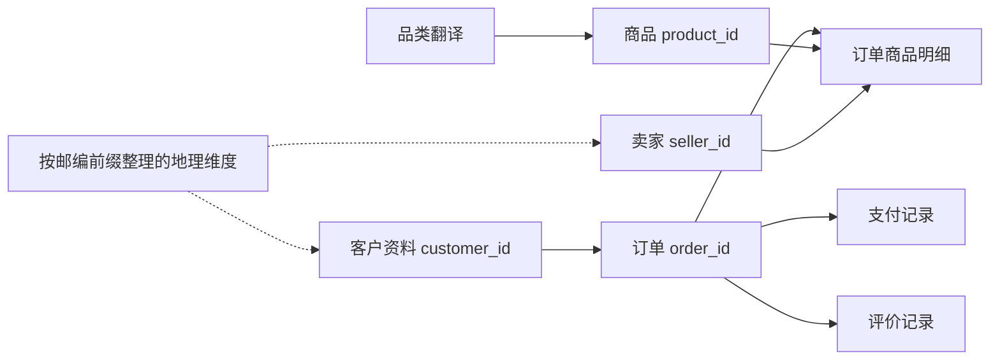

# 第 1 课：认识数据

这次先做 30–45 分钟。目标是理解数据的组织方式，并亲自运行最基础的 Pandas；暂时不做清洗或画 BI。

## 1. 先认清三种数量

本机原始数据：订单 99,441 笔；商品明细 112,650 行；客户表 99,441 行，对应 `customer_unique_id` 96,096 个。

“行数”不一定等于“订单数”或“客户数”。**粒度**就是一行代表什么。

| 原始文件 | 行数 | 一行代表什么 | 要注意什么 |
| --- | ---: | --- | --- |
| olist_orders_dataset.csv | 99,441 | 一个订单 | `order_id` 用于识别订单 |
| olist_order_items_dataset.csv | 112,650 | 一个订单内的一条商品明细 | 组合键为 `order_id + order_item_id` |
| olist_order_payments_dataset.csv | 103,886 | 一个订单的一条支付记录 | 一单可能多条支付，需先汇总 |
| olist_order_reviews_dataset.csv | 99,224 | 一条评价记录 | 不能预设 `review_id` 或 `order_id` 唯一 |
| olist_customers_dataset.csv | 99,441 | 一个 `customer_id` 对应的客户资料 | 复购要看 `customer_unique_id` |
| olist_products_dataset.csv | 32,951 | 一个商品 | 商品属性和品类存在缺失 |
| olist_sellers_dataset.csv | 3,095 | 一个卖家 | 与商品明细关联 |
| olist_geolocation_dataset.csv | 1,000,163 | 一个邮编前缀关联的地理记录 | 邮编前缀不唯一，原始表有整行重复 |
| product_category_name_translation.csv | 71 | 一个品类翻译映射 | 用葡语品类名关联 |

`数据含义.csv` 是辅助说明，不是第十张业务数据表，读取编码为 `gb18030`；其内容也需要与实际字段核对。

## 2. 打开 Notebook 并逐格运行

在 Anaconda Prompt 或 PowerShell 中：

```powershell
Set-Location 'D:\数据分析\olist-operations-analytics'
python -m notebook
```

在 Jupyter 中打开 `notebooks/01_认识数据.ipynb`。用 `Shift + Enter` 逐格运行。

第一段核心代码：

```python
from pathlib import Path
import pandas as pd

data_dir = Path(r'D:\数据分析\archive')
orders = pd.read_csv(data_dir / 'olist_orders_dataset.csv', dtype=str)
customers = pd.read_csv(data_dir / 'olist_customers_dataset.csv', dtype=str)
items = pd.read_csv(data_dir / 'olist_order_items_dataset.csv', dtype=str)

print(orders.shape)
print(customers['customer_unique_id'].nunique())
print(items.shape)
```

- `Path` 表示文件路径；开头的 `r` 避免 Windows 反斜杠被当作转义。
- `pd.read_csv` 把 CSV 读成 DataFrame，可理解为带列名的数据表。
- `dtype=str` 暂时把原始字段当字符串，防止邮编前导零丢失；第二阶段再明确转换金额和时间。
- `shape` 返回 `(行数, 列数)`。
- `nunique()` 统计不同值的个数，默认不计空值；它不等于行数。

预期输出分别是 `(99441, 8)`、`96096`、`(112650, 7)`。如果路径或环境报错，保留完整报错，不要直接改数据。

## 3. 看懂关联关系



箭头表示关联方向，不代表所有关系都是一对多；实际唯一性以盘点结果为准。地理原表需先整理，不能把它直接作为唯一维度。

最重要的坑：假设某订单有 2 条商品、2 条支付，按 `order_id` 直接合并会得到 2×2=4 行，每条商品金额出现两次。如果继续合并多条评价，重复会进一步增加。`COUNT(DISTINCT order_id)` 只能修正订单计数，不能修正重复求和。后面会学习先把支付汇总到订单粒度，再与订单关联；商品分析保留明细粒度。

## 4. 亲自完成四道小练习

1. 写出订单表、商品明细表、支付表各自“一行代表什么”，并解释为什么后两张表的行数不能直接当订单数。
2. 用 `nunique()` 分别统计两个客户 ID。说明为什么用 `customer_id` 统计复购会有问题。
3. 用 `value_counts(dropna=False)` 查看订单状态，写下 `delivered` 的数量。思考商品成交额分析为什么要先选订单状态。
4. 不运行 SQL，用自己的话解释：一单 2 条商品和 2 条支付合并后为什么是 4 行，怎样避免金额重复。

把自己的回答写在 Notebook 最后一格。数值可以对照报告，解释请自己组织语言。

## 这一课完成后的下一步

后面将把这些观察变成清洗规则：什么值应保留、什么异常要标记、哪些不能随意填补。届时按表逐项讲解，并编写第一份可复用清洗脚本。

## 5.作业

1. 每一个订单对应的customer_id，订单的状态，订单付款的时间，订单到达的时间，订单到达物流方的时间，订单到达客户方的时间，订单预计到达方的时间
2. print('customer_id:',customer['customer_id'].nunique()) 
    print('customer_unique_id:',customer['customer_unique_id'].nunique()) 
因为customer_unique_id可能会对应到好几个不同的customer_id,这些不同的customer_id属于相同的客户，如果用customer_id统计复购数据就会漏掉复购的次数
3. orders['order_status'].value_counts(dropna=False) delivered有96478例，在商品成交额分析中先选订单状态是因为，方便计算和分情况计算成交额，例如如果商品的状态是deliver，则我们在计算成交额时不需要考虑其他因素，直接计算即可。
4. order_id,item_id,price构成一个表，这个表有两行，因为item_id对应不同的price。order_id,payment_seq,payment_value构成一个表，这个表也有两行，因为不同的payment_seq对应不同的payment_value。所以，把这个两个表按照order_id合并，会得到一个4行的表。应该先合并price/payment_value之后再按照order_id合并表格。

## 6.批改
1. - 订单表：一行代表一个订单，通过 order_id 识别。
    - 商品明细表：一行代表某个订单中的一条商品明细，通过 order_id + order_item_id 识别。
    - 支付表：一行代表某个订单的一条支付记录，通过 order_id + payment_sequential 识别。
一个订单可能包含多条商品明细、使用多条支付记录，所以后两张表的行数不能直接当作订单数。
2. customer_id 用于关联订单表与客户表；customer_unique_id 用于在数据集中识别同一客户。同一客户在不同订单中可能对应不同的 customer_id，因此统计复购时应通过 customer_unique_id 汇总其不同订单。使用 customer_id 会把同一客户拆开，低估复购。
3. 分析成交额前应先明确订单状态，以确定纳入统计的订单范围。例如，本项目可以把“已交付订单的商品金额”作为主要经营口径，取消、不可用和在途订单分别统计，避免混入不同业务状态的金额。
4. 两张表中，同一个 order_id 都出现两次。关联时，每条商品都会匹配两条支付记录，所以得到 2 × 2 = 4 行。如果目标是一行一个订单，先在商品表中按 order_id 汇总 price，再在支付表中按 order_id 汇总 payment_value，最后关联这两张订单级汇总表。

## 名词解释
统计口径：统计时定下一套统一规则，规定“算什么，不算什么，怎么算”算账的统一规定，不同口径的数据没有可比性
“字段”是每一列存什么，“粒度”是一行记录代表什么